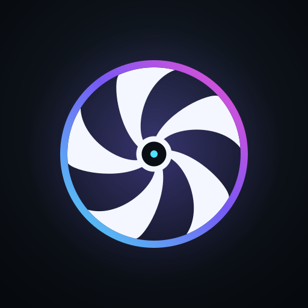
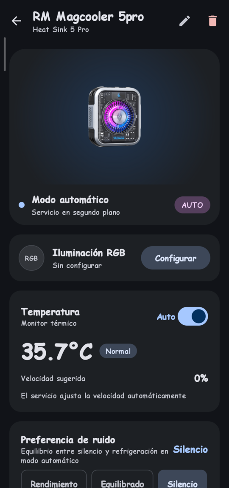
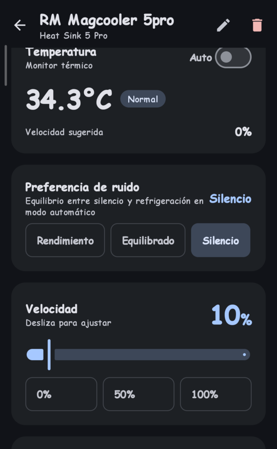
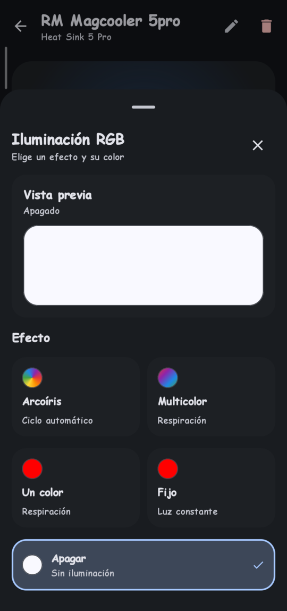

<p align="center">
  
</p>

<h1 align="center">RedmagicCooler</h1>

<p align="center">
  Control RedMagic / Nubia magnetic phone coolers from Android over Bluetooth LE.<br>
  Fan speed, automatic thermal mode, RGB lighting, and multiple cooler profiles — all handled locally on your phone.
</p>

<p align="center">
  <a href="https://github.com/Hitomatito/RedmagicCooler/releases/latest"><strong>Download the latest APK</strong></a>
</p>

<p align="center">
  <a href="https://github.com/Hitomatito/RedmagicCooler/actions/workflows/ci.yml">
    
  </a>
  <a href="https://github.com/Hitomatito/RedmagicCooler/releases/latest">
    
  </a>
  <a href="LICENSE">
    
  </a>
  
  
</p>

<table align="center">
  <tr>
    <td align="center"></td>
    <td align="center"></td>
    <td align="center"></td>
  </tr>
  <tr>
    <td align="center"><em>Automatic thermal mode</em></td>
    <td align="center"><em>Manual fan control</em></td>
    <td align="center"><em>RGB lighting</em></td>
  </tr>
</table>

## Features

- **Manual fan control** — 0–100% slider with 0%, 50%, and 100% presets.
- **Automatic thermal mode** — monitors battery and system thermal sensors and drives the fan in the background with a foreground service.
- **Noise preference** — balance between silence and cooling in automatic mode.
- **RGB lighting** — rainbow, breathing, solid color, and off, with a color picker.
- **Multiple cooler profiles** — save, rename, and switch between coolers.
- **Automatic reconnect** — retries with backoff after a dropped BLE connection.
- **Material You** — dynamic color on Android 12+, edge-to-edge Compose UI.
- **Local-first** — no internet permission, no accounts, no telemetry.

## Supported devices

| Generation | Model | Compatibility |
| :---: | --- | --- |
| 1 | Dual-Core Cooler | Supported by UUID |
| 2 | Turbo Cooler | Supported by UUID |
| 3 | Magcooler | Supported by UUID |
| 4 | Heat Sink 4 Pro | Supported by UUID |
| 5 | Heat Sink 5 Pro | Hardware-tested |
| 5 | Heat Sink 5 | Supported by UUID |
| 6 | Heat Sink 6 | Supported by UUID |
| 6 | Heat Sink 6 Pro | Supported by UUID |
| 6 | Heat Sink 6 Pro+ | Supported by UUID |

> [!IMPORTANT]
> Only the **Heat Sink 5 Pro** has been tested on real hardware. If your model behaves differently, open an issue with a Logcat capture.

<details>
<summary><strong>Usage</strong></summary>

1. Power on the cooler and keep it near the phone.
2. Open the app and grant the requested Bluetooth, location, and notification permissions.
3. Tap the add button, choose your cooler model, and scan.
4. Use the fan slider or the 0/50/100 presets, enable automatic mode for thermal control, or open the RGB screen.
5. While automatic mode is active, a foreground service keeps monitoring in the background with notification controls.

</details>

<details>
<summary><strong>How automatic mode works</strong></summary>

Automatic mode fuses several thermal sources instead of trusting a single reading: skin/battery comfort temperature, SoC (CPU/GPU) temperature rescaled to the comfort scale, and Android's system thermal status (0–6), with charging and screen state as context. It maps the fused temperature to a recommended fan speed and ramps the cooler up or down with minimum step and dwell-time guards to avoid rapid oscillation. A confirmed critical state still overrides the fusion and jumps toward maximum speed.

Each profile offers a **noise preference** in automatic mode — *Rendimiento* (25), *Equilibrado* (50, default), or *Silencio* (75). It scales the fan curve and tunes the ramp steps and dwell times. Safety is never traded away: confirmed critical risk ignores the preference, and the OS thermal status always imposes a minimum speed.

</details>

<details>
<summary><strong>Permissions</strong></summary>

| Permission | Why it is requested |
| --- | --- |
| `BLUETOOTH_SCAN`, `BLUETOOTH_CONNECT`, `BLUETOOTH_ADVERTISE` (Android 12+) | Discover, connect to, and control the cooler. |
| `BLUETOOTH`, `BLUETOOTH_ADMIN` (Android 11 and below) | Legacy Bluetooth LE access. |
| `ACCESS_FINE_LOCATION`, `ACCESS_COARSE_LOCATION` | Required by Android's BLE scanning APIs. The app does not use your location for anything else. |
| `POST_NOTIFICATIONS` (Android 13+) | Show the foreground-service notification and its controls. |
| `SCHEDULE_EXACT_ALARM` (Android 12+) | Reserved for future scheduled automation; not required for manual or automatic mode. |

The app declares no `INTERNET` permission. Cooler data and profiles stay on the device.

</details>

<details>
<summary><strong>How it works (BLE protocol)</strong></summary>

The BLE protocol was reverse-engineered from Logcat captures of the official Nubia app; there is no public specification. The app uses the RedMagic advertising service and the cooler's fan service:

| Purpose | UUID |
| --- | --- |
| RedMagic advertising service | `00004a41-0000-1000-8000-00805f9b34fb` |
| Fan service | `d52082ad-e805-9f97-9d4e-1c682d9c9ce6` |
| Fan speed characteristic | `00001012-0000-1000-8000-00805f9b34fb` |
| Status notifications (multiplexed frames) | `00001015-0000-1000-8000-00805f9b34fb` |
| RGB control | `00001013-0000-1000-8000-00805f9b34fb` |
| Automatic mode control | `00001018-0000-1000-8000-00805f9b34fb` |

Fan speed is sent as a raw value between `40` and `80`, mapped from the UI's 0–100% range. The full list of model-specific manufacturer subtypes lives in [`CoolerDeviceType.kt`](app/src/main/java/com/hitomatito/redmagicooler/CoolerDeviceType.kt).

> [!WARNING]
> Firmware updates can change UUIDs or packet formats. If a cooler stops responding after an update, capture a Logcat and open an issue with the model and phone details.

</details>

<details>
<summary><strong>Architecture</strong></summary>

| Component | Responsibility |
| --- | --- |
| `MainActivity` | Compose host and navigation; observes the BLE engine and issues commands. |
| `CoolerService` | Foreground service for automatic mode: notifications, thermal loop, and BLE commands via the shared engine. |
| `ThermalMonitor` / `ThermalLogic` | System thermal zones classified by role (CPU/GPU/skin), battery, charging and screen state, plus the pure-Kotlin speed decision engine with noise-preference tuning. |
| `ProfileRepository` | Local profile storage using SharedPreferences and JSON. |
| `ble/` | Single GATT owner and op queue. |

**Stack:** Kotlin 2.4.21, Jetpack Compose, Material 3, Coroutines/Flow, Navigation Compose, WorkManager, and Android BLE GATT. Targets Android 17 (API 37), supports Android 7.0 (API 24) and newer.

</details>

## Build from source

Requirements: JDK 21, Android SDK Platform 37, Build Tools 36.0.0, Gradle 9.9.1 (wrapper). If `java` is not on your `PATH`, export `JAVA_HOME` pointing to a JDK 21 before running `./gradlew`.

```bash
git clone https://github.com/Hitomatito/RedmagicCooler.git
cd RedmagicCooler
./gradlew assembleDebug        # debug APK in app/build/outputs/apk/debug/
./gradlew testDebugUnitTest    # unit tests
```

For a signed release build, create a gitignored `keystore.properties` in the project root (`storeFile`, `storePassword`, `keyAlias`, `keyPassword`), then run `./gradlew assembleRelease`.

GitHub Actions runs the unit tests and builds debug and release variants on every push to `main` and on pull requests.

<details>
<summary><strong>Troubleshooting</strong></summary>

**The cooler is not detected**

- Make sure the cooler is powered on and not connected to another phone.
- Confirm Bluetooth is enabled and the app has the required nearby-devices and location permissions.
- Toggle Bluetooth off and on, then scan again.

**The connection drops after about 30 seconds**

Some coolers stop answering GATT service discovery after a disconnect: Android terminates the link with `status 22`. The official Nubia app shows the same behavior, so this is a cooler firmware or phone Bluetooth-stack limitation rather than an app bug. The app retries up to five times; toggling Bluetooth off and on usually recovers the connection.

**The fan slider is disabled**

Manual fan control is disabled while automatic mode is active. Turn automatic mode off to use the slider or the presets.

</details>

## Known limitations

- The in-app UI is currently Spanish-only.
- Only the Heat Sink 5 Pro has been hardware-tested.
- The BLE protocol is unofficial and may break with firmware updates.
- One cooler can be controlled at a time; additional coolers are stored as profiles.
- Scheduled automation and the WorkManager worker are scaffolding, not a finished feature.

## Disclaimer

This project is not affiliated with, endorsed by, or supported by Nubia, RedMagic, or ZTE. Bluetooth commands are sent directly to your hardware; use the app at your own risk.

Product images of the coolers bundled with the app are property of Nubia/RedMagic and are used only to identify compatible models. The app's logo and source code are original work.

Licensed under the [MIT License](LICENSE).
