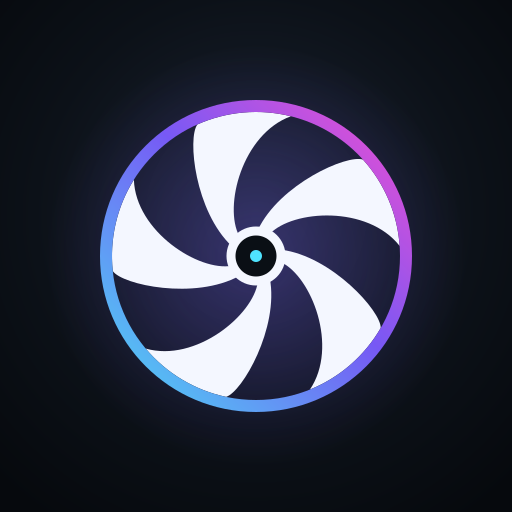

<p align="center">
  
</p>

<h1 align="center">RedmagicCooler</h1>

<p align="center">
  <strong>Unofficial Android control for RedMagic magnetic coolers over Bluetooth LE.</strong><br>
  Fan speed, automatic thermal mode, RGB lighting, and multiple cooler profiles — all handled locally on your phone.
</p>

<p align="center">
  <a href="https://github.com/Hitomatito/RedmagicCooler/actions/workflows/ci.yml">
    
  </a>
  <a href="https://github.com/Hitomatito/RedmagicCooler/releases/latest">
    
  </a>
  <a href="LICENSE">
    
  </a>
  
  
</p>

RedmagicCooler is a community-built Android client for RedMagic / Nubia magnetic coolers. It talks directly to the cooler over Bluetooth LE, so you can control the fan, enable automatic thermal regulation, and change the RGB lighting without the official app.

> [!NOTE]
> This project is not affiliated with, endorsed by, or supported by Nubia, RedMagic, or ZTE.

## Features

- **Manual fan control** — 0–100% slider with 0%, 50%, and 100% presets.
- **Automatic thermal mode** — monitors battery and system thermal sensors and adjusts fan speed in progressive steps with dwell-time and minimum-step guards.
- **RGB lighting** — rainbow, multi-color breathing, single-color breathing, solid color, and off, with an RGB color picker.
- **Foreground service for automatic mode** — thermal monitoring and fan adjustments continue in the background, with a persistent notification and controls.
- **Automatic reconnect** — retries with backoff after a dropped BLE connection.
- **Multiple cooler profiles** — save, rename, delete, and switch between coolers. One cooler is controlled at a time.
- **Material You** — dynamic color on Android 12+, edge-to-edge Compose UI, and a branded splash screen.
- **Local-first** — no internet permission, no accounts, and no telemetry. Profiles stay on the device.

## Supported devices

The app matches each cooler by its BLE advertising UUID. Choose your model in the app, then scan.

| Generation | Model | Compatibility |
| :---: | --- | --- |
| 1 | Dual-Core Cooler | Supported by UUID |
| 2 | Turbo Cooler | Supported by UUID |
| 3 | Magcooler | Supported by UUID |
| 4 | Heat Sink 4 Pro | Supported by UUID |
| 5 | Heat Sink 5 Pro | Hardware-tested |
| 5 | Heat Sink 5 | Supported by UUID |
| 6 | Heat Sink 6 | Supported by UUID |
| 6 | Heat Sink 6 Pro | Supported by UUID |

> [!IMPORTANT]
> Only the **Heat Sink 5 Pro** has been tested on real hardware. The other models use their advertised UUIDs but have not been verified by the maintainer. If your model behaves differently, open an issue with a Logcat capture.

## Installation

### Install the APK

1. Download the latest APK from [Releases](https://github.com/Hitomatito/RedmagicCooler/releases/latest).
2. Allow installation from unknown sources if Android asks.
3. Install and open the app.

### Build from source

Requirements:

| Tool | Version |
| --- | --- |
| JDK | 21 |
| Android SDK Platform | 36 |
| Android Build Tools | 36.0.0 |
| Gradle | 9.4.1 (wrapper) |

```bash
git clone https://github.com/Hitomatito/RedmagicCooler.git
cd RedmagicCooler
./gradlew assembleDebug
```

The debug APK is written to `app/build/outputs/apk/debug/`.

For a signed release build, create a `keystore.properties` file in the project root. It is gitignored and must never be committed:

```properties
storeFile=/absolute/path/to/release.jks
storePassword=...
keyAlias=...
keyPassword=...
```

Then run:

```bash
./gradlew assembleRelease
```

The release APK is written to `app/build/outputs/apk/release/`.

## Usage

1. Power on the cooler and keep it near the phone.
2. Open the app and grant the requested Bluetooth, location, and notification permissions.
3. Tap the add button, choose your cooler model, and scan.
4. Select the cooler and connect.
5. Use the fan slider or the 0/50/100 presets, enable automatic mode for thermal control, or open the RGB screen to choose an effect and color.
6. When automatic mode is active, a foreground service keeps thermal monitoring alive in the background. Use the notification actions to switch between automatic and manual mode or to reconnect.
7. Add more profiles for other coolers. The app stores each profile separately and connects to one cooler at a time.

### Automatic mode

Automatic mode reads the phone's battery and system thermal sensors, maps the highest available temperature to a recommended fan speed, and ramps the cooler up or down with minimum step and dwell-time guards to avoid rapid oscillation. Temperatures at or above the critical threshold jump directly to maximum speed. Manual fan control is disabled while automatic mode is active.

## Permissions

| Permission | Why it is requested |
| --- | --- |
| `BLUETOOTH_SCAN`, `BLUETOOTH_CONNECT`, `BLUETOOTH_ADVERTISE` (Android 12+) | Discover, connect to, and control the cooler. |
| `BLUETOOTH`, `BLUETOOTH_ADMIN` (Android 11 and below) | Legacy Bluetooth LE access. |
| `ACCESS_FINE_LOCATION`, `ACCESS_COARSE_LOCATION` | Required by Android's BLE scanning APIs, especially on Android 11 and below. The app does not use your location for anything else. |
| `POST_NOTIFICATIONS` (Android 13+) | Show the foreground-service notification and its controls. |
| `SCHEDULE_EXACT_ALARM` (Android 12+) | Reserved for future scheduled automation; not required for manual or automatic mode. |

> [!NOTE]
> The app declares no `INTERNET` permission. Cooler data and profiles stay on the device; nothing is uploaded to a server.

## How it works

The BLE protocol was reverse-engineered from Logcat captures of the official Nubia app. There is no public specification for these coolers.

The app uses the RedMagic advertising service and the cooler's fan service:

<details>
<summary>BLE service and characteristic UUIDs</summary>

| Purpose | UUID |
| --- | --- |
| RedMagic advertising service | `00004a41-0000-1000-8000-00805f9b34fb` |
| Fan service | `d52082ad-e805-9f97-9d4e-1c682d9c9ce6` |
| Fan speed characteristic | `00001012-0000-1000-8000-00805f9b34fb` |
| Temperature notifications | `00001015-0000-1000-8000-00805f9b34fb` |
| RGB control | `00001013-0000-1000-8000-00805f9b34fb` |
| Automatic mode control | `00001018-0000-1000-8000-00805f9b34fb` |

Fan speed is sent as a raw value between `40` and `200`, mapped from the UI's `0–100%` range. The full list of model-specific advertising UUIDs lives in [`CoolerDeviceType.kt`](app/src/main/java/com/hitomatito/redmagicooler/CoolerDeviceType.kt).

</details>

> [!WARNING]
> Firmware updates can change UUIDs or packet formats. If a cooler stops responding after an update, capture a Logcat and open an issue with the model and phone details.

## Architecture

| Component | Responsibility |
| --- | --- |
| `MainActivity` | Compose host, navigation, and BLE orchestration. |
| `CoolerService` | Foreground service: GATT connection, automatic mode, notifications, and reconnect backoff. |
| `ThermalMonitor` | Battery and system thermal sensors, temperature levels, and recommended fan speed. |
| `ProfileRepository` | Local profile storage using SharedPreferences and JSON. |
| `ui/` | Home, Add device, Profile, and RGB screens with a Material 3 theme. |
| `model/` | BLE constants, supported cooler types, profiles, and RGB configuration. |

**Stack:** Kotlin 2.3, Jetpack Compose, Material 3, Coroutines/Flow, Navigation Compose, WorkManager, and Android BLE GATT. The app targets Android 16 (API 36) and supports Android 7.0 (API 24) and newer.

## Development

Run the unit tests and build the app:

```bash
./gradlew test
./gradlew assembleDebug
./gradlew assembleRelease
```

GitHub Actions runs the unit-test task and builds debug and release variants with R8 and resource shrinking on every push to `main` and on pull requests.

Pull requests are welcome. For BLE issues, include the cooler model, phone model, Android version, and a Logcat capture. The reverse-engineered protocol is the most likely source of model-specific bugs.

## Troubleshooting

### The cooler is not detected

- Make sure the cooler is powered on and not connected to another phone.
- Confirm that Bluetooth is enabled and the app has the required nearby-devices and location permissions.
- Toggle Bluetooth off and on, then scan again.

### The connection drops after about 30 seconds

Some coolers stop answering GATT service discovery after a disconnect. The BLE link is established, but the cooler does not respond to ATT requests and Android terminates the connection with `status 22` after roughly 30 seconds. The official Nubia app shows the same behavior, so this is a cooler firmware or phone Bluetooth-stack limitation rather than an app bug.

**Workaround:** toggle Bluetooth off and on, then reconnect. The app retries up to three times before showing the error.

### The fan slider is disabled

Manual fan control is disabled while automatic mode is active. Turn automatic mode off to use the slider or the presets.

## Known limitations

- The in-app UI is currently Spanish-only.
- Only the Heat Sink 5 Pro has been hardware-tested.
- The BLE protocol is unofficial and may break with firmware updates.
- One cooler can be controlled at a time; additional coolers are stored as profiles.
- Scheduled automation and the WorkManager worker are scaffolding, not a finished feature.

## Disclaimer

This is an unofficial community project. It is not affiliated with, endorsed by, or supported by Nubia, RedMagic, or ZTE. Bluetooth commands are sent directly to your hardware; use the app at your own risk.

Product images of the coolers bundled with the app are property of Nubia/RedMagic and are used only to identify compatible models. The app's logo and source code are original work.

Licensed under the [MIT License](LICENSE).
