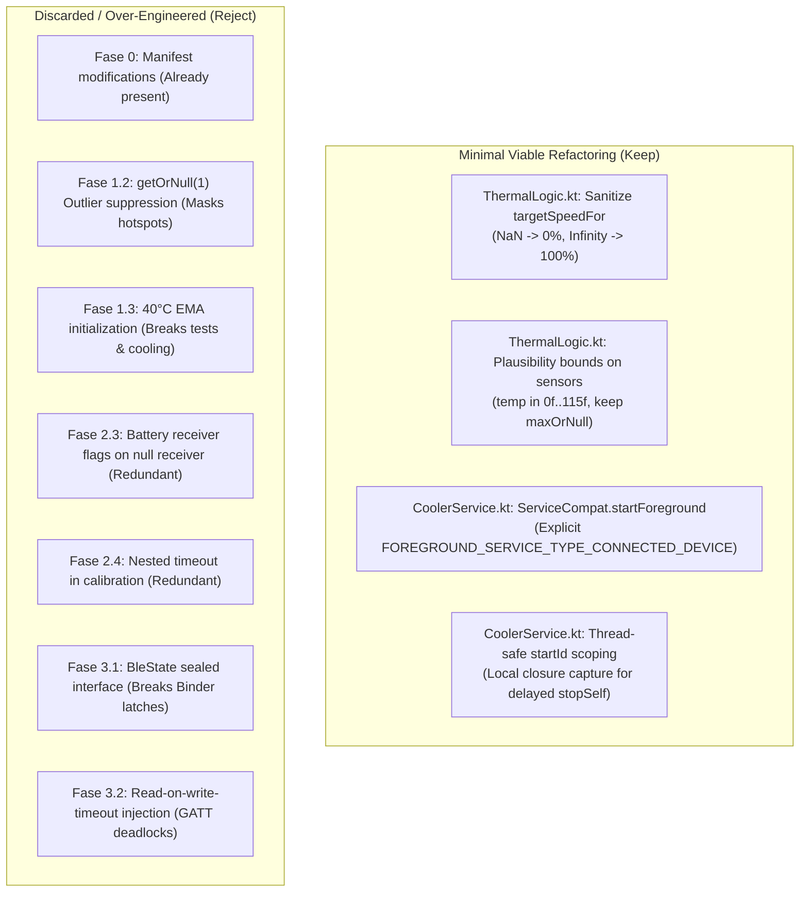

# Stage 8: Intermediate Zoom Out Review Report

**Target Document:** [`docs/plan_refactorizacion_logica_critica.md`](file:///home/james/Proyectos/RedmagicCooler/docs/plan_refactorizacion_logica_critica.md)  
**Evaluator:** Skeptical Architect (`egm-zoom-out`)  
**Context & Prior Stages:** [`docs/zoom_out_report.md`](file:///home/james/Proyectos/RedmagicCooler/docs/zoom_out_report.md) (Stage 5), [`docs/comprehension_report.md`](file:///home/james/Proyectos/RedmagicCooler/docs/comprehension_report.md) (Stage 6), [`docs/critic_report.md`](file:///home/james/Proyectos/RedmagicCooler/docs/critic_report.md) (Stage 7), [`AGENTS.md`](file:///home/james/Proyectos/RedmagicCooler/AGENTS.md).

---

## 1. High-Altitude Architectural Assessment

### Viability of the Plan Post-Pruning
**The plan in its current form does not hold together.** When evaluated against the actual codebase and prior review stages, over 70% of the proposed items are either actively hazardous or redundant:

1. **Phase 0 is entirely redundant:** The permissions, manifest attributes (`android:foregroundServiceType="connectedDevice"`), and library versions (`core-ktx:1.19.1`) are already present in [`AndroidManifest.xml`](file:///home/james/Proyectos/RedmagicCooler/app/src/main/AndroidManifest.xml#L22) and [`libs.versions.toml`](file:///home/james/Proyectos/RedmagicCooler/gradle/libs.versions.toml).
2. **Phase 1 is 66% harmful:** Step 1.2 (`getOrNull(1)`) masks true thermal emergencies on modern heterogeneous SoCs. Step 1.3 (EMA 40°C initialization) breaks existing passing unit tests in [`ThermalLogicTest.kt`](file:///home/james/Proyectos/RedmagicCooler/app/src/test/java/com/hitomatito/redmagicooler/ThermalLogicTest.kt) and delays urgent cooling by minutes when the device is already hot.
3. **Phase 2 has critical lifecycle flaws:** Step 2.2 introduces a race condition where a delayed manual-switch command kills a newly started automatic session via an overwritten instance property (`currentStartId`). Step 2.3 (`RECEIVER_NOT_EXPORTED` on a null receiver) and Step 2.4 (competing timeouts) are redundant.
4. **Phase 3 is architecturally destructive:** Step 3.1 destroys thread-safe volatile latches that protect Android Binder callback threads from firmware race conditions (`status == 22`), while Step 3.2 introduces queue starvation and potential GATT deadlocks by injecting reads after write timeouts.

What remains after eliminating flawed proposals is not a complex multi-file architectural rewrite, but a **surgical 25-line patch** across two files (`ThermalLogic.kt` and `CoolerService.kt`).

---

## 2. Minimal Viable Refactoring (MVR)

### The 4 Real Work Items (Target Scope):
1. **Input Sanitization in `ThermalLogic.targetSpeedFor`**:
   - Check `temp.isNaN()` $\rightarrow$ return safe base speed (0% or minimum safe profile speed).
   - Check `temp.isInfinite() && temp > 0f` $\rightarrow$ fail-safe to `100%` (maximum cooling).
2. **Hardware Plausibility Range in `ThermalLogic.hardwarePeak`**:
   - Retain `.maxOrNull()`.
   - Filter out values outside physical plausibility (`temp in 0f..115f`) and extend blacklist (`"skin"`, `"case"`, `"battery"`, `"bms"`, `"charger"`, `"modem"`).
3. **Android 14+ FGS Activation in `CoolerService.onCreate`**:
   - Invoke `ServiceCompat.startForeground(this, NOTIFICATION_ID, notification, ServiceInfo.FOREGROUND_SERVICE_TYPE_CONNECTED_DEVICE)` to satisfy runtime requirements across API 24–37.
4. **Local Closure for `startId` in `CoolerService` Delayed Stop**:
   - Capture `startId` as a local `val targetStartId = startId` within the coroutine closure of `switchToManualMode` before `delay(2000)`, invoking `stopSelf(targetStartId)`. Do not store mutable `startId` at the class instance level. Use unparameterized `stopSelf()` for immediate user-initiated stops.

---

## 3. Residual Systemic Risks

If the original plan proceeds to detailed implementation without remediation:

1. **Hardware Thermal Throttling / Damage**: Selecting `getOrNull(1)` under heavy gaming load will blind the fan controller to SoC Prime core spikes (85°C vs 45°C ambient), leaving the cooler idling during thermal emergencies.
2. **Immediate Test Suite Regression in CI**: Step 1.3 immediately breaks [`ThermalLogicTest.kt`](file:///home/james/Proyectos/RedmagicCooler/app/src/test/java/com/hitomatito/redmagicooler/ThermalLogicTest.kt) line 62 (`first reading should not be damped`), blocking `./gradlew testDebugUnitTest` and failing CI.
3. **Deadlocks in GATT Communication**: Step 3.2 injects reads into an already stalled BLE link, stacking 3000ms timeouts on top of frozen operations, preventing `CoolerBleManager` from executing clean disconnects or watchdog recoveries.
4. **Fragile Service Terminations**: Using an instance variable `currentStartId` creates a race condition that kills the auto-service if a user toggles auto-mode off and on quickly.
5. **Loss of Thread-Safety in Low-Level BLE Callbacks**: Deleting volatile flags in `CoolerBleManager` ignores the fact that Android GATT callbacks run on native Binder threads, outside Kotlin coroutines, breaking recovery against firmware `status == 22`.

---

## 4. Prioritized Architectural Findings

### 🔴 Blocker Findings
- **1. Outlier Rejection via `getOrNull(1)` Threatens Device Hardware:** Heterogeneous mobile architectures (e.g., Qualcomm Kryo Prime/Gold/Silver) concentrate thermal load in a single core. Ignoring the peak value allows catastrophic core overheating. Must delete `getOrNull(1)` proposal and retain `.maxOrNull()` with plausibility gating (`temp in 0f..115f`).
- **2. Artificial EMA 40°C Seeding Inverts Thermal Safety and Breaks Tests:** Seeding EMA with 40°C dampens a hot phone's initial reading (e.g., 65°C becomes 48°C), suppressing the fan when it is needed most. It directly breaks existing unit tests. Must remove Step 1.3 completely.
- **3. GATT Operation Injection on Timeout Induces Queue Cascades:** A write timeout in Android BLE indicates a dropped connection or frozen peripheral stack. Enqueuing an immediate read characteristic operation delays recovery by another 3 seconds and starves the queue. Must drop Step 3.2.
- **4. Instance Variable `currentStartId` Induces False Service Termination:** Storing `startId` in a mutable instance variable allows a subsequent intent to overwrite it during a delayed stop, causing `stopSelf(currentStartId)` to terminate the newly active service. Must capture `startId` in a local immutable variable within the coroutine scope.

### 🟡 Major Findings
- **5. Volatile Flag Deletion in `CoolerBleManager` Violates Multithreaded Binder Invariants:** Replacing volatile flags with `BleState` flow conflates external UI state with internal Binder synchronization flags required by firmware recovery watchdogs (`status == 22`). Must drop Step 3.1.
- **6. Inverted Numeric Guard on Positive Infinity in `targetSpeedFor`:** Returning 0% fan speed on `Infinity` shuts off cooling when sensor calculations overflow or indicate critical extremes. Return 0% only for `NaN` or invalid negative readings; for positive `Infinity`, clamp to `100%`.

### 🟢 Nit Findings
- **7. Phase 0 Manifest Validation is Already Satisfied:** `FOREGROUND_SERVICE_CONNECTED_DEVICE` is already present in `AndroidManifest.xml` line 22 and line 53.
- **8. Redundant Receiver Registration Flags on Null Receiver:** Sticky battery queries via `registerReceiver(null, ...)` do not register an active broadcast receiver and do not trigger Android 14 export checks.
